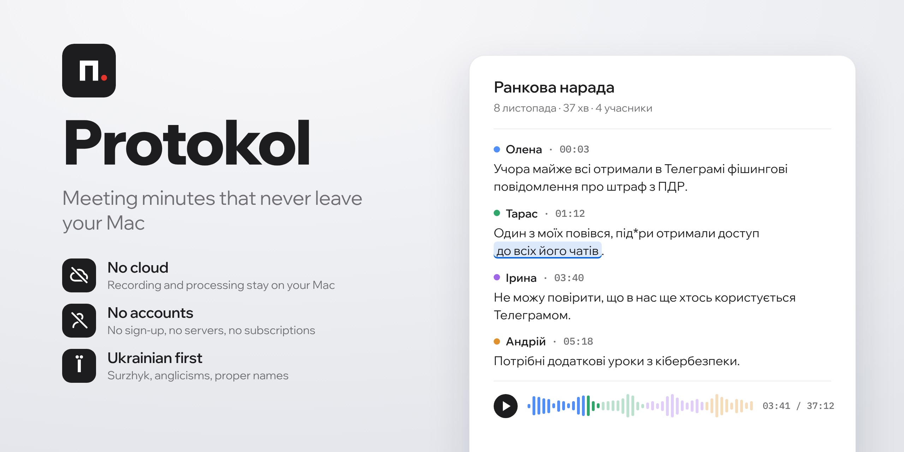

  <picture>
    <source media="(prefers-color-scheme: dark)" srcset="docs/assets/hero-en-dark.png">
    <source media="(prefers-color-scheme: light)" srcset="docs/assets/hero-en-light.png">
    
  </picture>

  
  
  

<a href="README.md">Українська</a> · <b>English</b>

## Who it is for

For anyone whose meetings include things that must not fall into the wrong hands: public bodies and communities, lawyers, doctors, businesses, NGOs, journalists. And for anyone who simply does not want their conversations in someone else's cloud.

## Why it is built this way

- **Everything stays on your Mac.** Recording, speech recognition and summaries work without a network. The internet is only needed to download models and updates.
- **No accounts or subscriptions.** No servers of ours, no sign-up, no monthly fee.
- **Open source.** Anyone can check what the app does and does not do.
- **Ukrainian first.** Recognition is tuned for living speech: surzhyk, anglicisms, proper names. The app learns from your corrections.
- **Transcript.** Only what was actually said. The language model only condenses each speaker's remarks; the final word always belongs to a person.
- **Free.** MIT licence.

## What it does

<!-- screenshot: transcript -->
**Recording.** An online call in Meet, Zoom or Teams, or a conversation in a room: microphone and call audio.

**Who spoke.** Voices are separated automatically, and familiar people are recognised next time.

**Transcript.** Lines like "Name · 00:03". Click a word to hear it. Unsure words are marked and corrections are remembered.

**Document.** A summary per speaker and an overall summary. DOCX, PDF, copy the whole transcript or one speaker.

## How it works

<!-- diagram: pipeline -->
Recording → Recognition → Who spoke → Transcript → Document. Every step runs on your Mac.

## Install

1. Download the `.dmg` from [Releases](../../releases/latest).
2. Drag **Протокол** to Applications.
3. The app is not yet signed with an Apple certificate. On first launch open System Settings → Privacy & Security → **Open Anyway**.
4. Allow the microphone and screen recording (needed for call audio).
5. Download the models, about 10 GB.

Details: [docs/en/install.md](docs/en/install.md).

## Requirements

| | |
|---|---|
| Computer | Apple Silicon Mac |
| Memory | 16 GB recommended; on 8 GB processing is slow and word highlight is off |
| Disk | about 15 GB free |

## Documentation

[Install](docs/en/install.md) · [First recording](docs/en/first-recording.md) · [Transcript](docs/en/transcript.md) · [Speakers](docs/en/speakers.md) · [Document](docs/en/document.md) · [Settings](docs/en/settings.md) · [Privacy](docs/en/privacy.md) · [FAQ](docs/en/faq.md)

## Licence and credits

MIT. Protokol is based on [Meetily](https://github.com/Zackriya-Solutions/meetily) by Zackriya Solutions (MIT). Model and library licences: [THIRD_PARTY_NOTICES.md](THIRD_PARTY_NOTICES.md). Build from source: [CONTRIBUTING.md](CONTRIBUTING.md).
