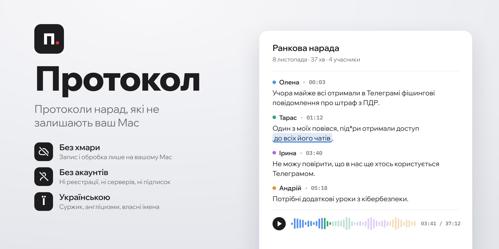

  <picture>
    <source media="(prefers-color-scheme: dark)" srcset="docs/assets/hero-uk-dark.png">
    <source media="(prefers-color-scheme: light)" srcset="docs/assets/hero-uk-light.png">
    
  </picture>

  
  
  

<b>Українська</b> · <a href="README.en.md">English</a>

## Для кого

Для всіх, у кого на нарадах звучить те, що не має потрапити в чужі руки: державні установи та громади, юристи, лікарі, бізнес, громадські організації, журналісти. І для кожного, хто просто не хоче віддавати свої розмови в чужу хмару.

## Чому саме так

- **Усе залишається на вашому Mac.** Запис, розпізнавання мовлення і підсумки працюють без мережі. Інтернет потрібен лише, щоб завантажити моделі та оновлення.
- **Без акаунтів і підписок.** Немає наших серверів, реєстрації чи щомісячної плати.
- **Відкритий код.** Будь-хто може перевірити, що програма робить і чого не робить.
- **Українська насамперед.** Розпізнавання налаштоване на живу мову: суржик, англіцизми, власні назви. Програма вчиться з ваших виправлень.
- **Стенограма.** У стенограмі тільки те, що прозвучало. Мовна модель лише стисло підсумовує виступи, а остаточне слово завжди за людиною.
- **Безкоштовно.** Ліцензія MIT.

## Що вміє

<!-- screenshot: transcript -->
**Запис.** Онлайн-дзвінок у Meet, Zoom чи Teams або розмова в кімнаті: мікрофон і звук дзвінка.

**Хто говорив.** Голоси розділяються автоматично, а знайомі люди впізнаються наступного разу.

**Стенограма.** Рядки «Ім'я · 00:03». Натисніть слово, щоб прослухати його. Непевні слова виділені, а виправлення запам'ятовуються.

**Документ.** Вижимка кожного спікера та загальний підсумок. DOCX, PDF, копіювання всієї стенограми чи одного виступу.

## Як це працює

<!-- diagram: pipeline -->
Запис → Розпізнавання → Хто говорив → Стенограма → Документ. Кожен крок виконується на вашому Mac.

## Встановлення

1. Завантажте `.dmg` зі сторінки [Releases](../../releases/latest).
2. Перетягніть **Протокол** у «Програми».
3. Програму поки не підписано сертифікатом Apple. Під час першого запуску відкрийте Системні параметри → Приватність і безпека → **Усе одно відкрити**.
4. Дозвольте мікрофон і запис екрана (потрібен для звуку дзвінка).
5. Завантажте моделі, приблизно 10 ГБ.

Докладно: [docs/uk/install.md](docs/uk/install.md).

## Вимоги

| | |
|---|---|
| Комп'ютер | Mac з Apple Silicon |
| Пам'ять | рекомендовано 16 ГБ; на 8 ГБ обробка довга, підсвітка слів вимкнена |
| Диск | близько 15 ГБ вільного місця |

## Документація

[Встановлення](docs/uk/install.md) · [Перший запис](docs/uk/first-recording.md) · [Стенограма](docs/uk/transcript.md) · [Спікери](docs/uk/speakers.md) · [Документ](docs/uk/document.md) · [Налаштування](docs/uk/settings.md) · [Приватність](docs/uk/privacy.md) · [Питання](docs/uk/faq.md)

## Ліцензія та подяки

MIT. Протокол створено на основі [Meetily](https://github.com/Zackriya-Solutions/meetily) (Zackriya Solutions, MIT). Ліцензії моделей та бібліотек: [THIRD_PARTY_NOTICES.md](THIRD_PARTY_NOTICES.md). Збірка з коду: [CONTRIBUTING.md](CONTRIBUTING.md).
