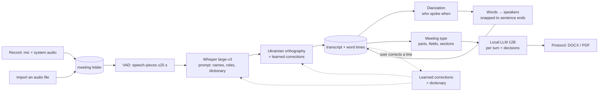

# Протокол — architecture

Протокол turns a recorded or imported meeting into a short, human protocol in
Ukrainian: who said what, decisions and tasks. Everything runs on the user's
Mac; nothing about a meeting leaves it.

It is a Tauri 2 desktop app: a Rust core (`frontend/src-tauri/src/`) and a
Next.js interface (`frontend/src/`). The project started as a fork of
Meetily; this document describes the app as it is now (version 0.2.7,
branch `speakers-by-voice`).

## 1. From sound to protocol

### 1.1 Recording (`audio/`)

- Microphone through CPAL, system audio (the call: Meet, Zoom, Teams)
  through a Core Audio process tap on macOS (`audio/capture/`,
  `system_audio_stream.rs`).
- Both are mixed into `audio.mp4`. The system channel is also kept alone
  (`system.m4a`), and the level of each channel every 100 ms goes to
  `channels.json` (`audio/channel_track.rs`). The levels later tell which
  speech was «Я» (the microphone) and which came from the call.
- While recording, text appears live (`audio/transcription/`). The mic can be
  muted in the app; the state is shown in the window, not written into the
  text.
- A floating «island» (`island.rs`) shows the timer and stop. The app's
  windows are hidden from screen sharing by default (`content_protected`).

### 1.2 Import (`audio/import.rs`)

An audio or video file is copied into a new meeting folder, decoded to 16 kHz
mono (Symphonia, FFmpeg as a fallback, `audio/decoder.rs`), cut into speech
pieces and transcribed. Speaker recognition starts by itself afterwards.

### 1.3 Speech pieces (`audio/vad.rs`)

Silero VAD finds speech; a pause of 2 s ends a piece; pieces longer than 25 s
are split at the quietest point (`audio/common.rs`). Pieces shorter than
0.1 s are skipped.

### 1.4 Recognition (`whisper_engine/`, `ukrainian/`)

- Whisper large-v3 (ggml, Metal on the Apple GPU), language forced to
  Ukrainian, beam search.
- The initial prompt (≤200 tokens, `ukrainian/mod.rs`) lists, in this order:
  the names and roles confirmed in «Спікери» (voice profiles), then the
  dictionary («Словник»: the user's terms and learned ones, most used first),
  then a few formal Ukrainian words. Order matters: a prompt that did not end
  on plain words made Whisper skip audio.
- After each piece: repeated and hallucinated text is dropped
  (`ukrainian/hallucination.rs`), surzhyk and Russian spellings are put into
  Ukrainian (`ukrainian/orthography.rs`), and the user's learned corrections
  are applied (`ukrainian/corrections.rs`, see 1.9).
- The same decoding also gives a time for every word (Whisper token
  timestamps). Import, re-transcription and the speaker pass save them as
  `words.json` in the meeting folder (`speakers/words.rs`).

### 1.5 Who spoke (`speakers/`)

- **Diarization** (`diarize.rs`): pyannote segmentation-3.0 (ONNX) on 10 s
  windows every 2 s with powerset decoding; a WeSpeaker ResNet34 voice
  embedding (ONNX, Kaldi fbank in `fbank.rs`) per stretch of speech;
  average-linkage clustering at cosine distance 0.6 (`cluster.rs`); voices
  whose centroids are ≥0.65 similar are joined; stretches under 1.5 s go to
  the nearest voice; tiny turns are smoothed.
- **«Я»** (`timeline.rs`): where the microphone was louder than the call,
  the speech is the recording person's.
- **Text to speakers** (`words.rs`): each word goes to the voice heard at its
  time. Word times are off by about a second, so a change of speaker inside a
  sentence moves to the nearer sentence end, a greeting opens the next turn
  and a closing phrase («в мене все») stays with its speaker. On a real
  33-minute meeting this raised word-level agreement with a slow per-turn
  transcription from 88% to 98%. Without `words.json` (a live recording)
  one Whisper pass with word times is made first and saved, so a repeat run
  takes about two minutes.
- **Names** (`names.rs`, `profiles.rs`): a voice that matches a saved voice
  profile gets its name and role. Otherwise a name may be suggested from what
  was said (a self-introduction at the start of a turn, an address right
  before it), shown as «Ім'я (?)» until confirmed. Confirming saves or
  updates the voice profile (mean embedding), so the same person is named by
  voice in the next meetings.
- Voices with less than 10 s of speech and no name are shown as «Репліки».
  Pairs of voices with similarity 0.55–0.65 are offered for merging.
- Runs in the background with progress events (`speakers-progress`,
  `speakers-done`) and can be stopped at any point; the transcript stays as
  it was.

### 1.6 Document templates (`summary/templates/`)

A document template is JSON: a name, a description and a `meeting` block:

| Field | Meaning |
| --- | --- |
| `blocks` | What the document has, in order: «Контроль», «Хід наради», «Рішення», «Завдання», «Відкриті питання», «Загальний підсумок», «Не доповідали», «Стенограма» |
| `ordered` | The document has exactly `blocks`, in that order. Templates saved before 0.3.8 lack it and write the speakers' blocks and the overall summary whatever `blocks` says |
| `classic` | Each speaker by `report_fields` («Зроблено», «План…», «Проблеми»…) instead of short points |
| `detailed` | «Докладніше»: more and longer points per speaker, a longer overall summary |
| `wishes` | «Побажання до тексту»: the secretary's own words, added to the model's instructions |
| `parts` | Optional parts in order: `title`, `cues` (phrases that open the part), `role` (one or several roles from «Спікери», comma-separated) |
| `title_hints`, `hours` | Words in the title and start hours, to suggest the template |
| `controls` | For «Контроль»: which earlier meeting's tasks to check |

Built in (`frontend/src-tauri/templates/`): «Підсумки доповідачів» (main),
«Рішення та завдання», «Доповіді за полями», «Стенограма», «Контрольна
нарада». «Щоденна нарада (доповіді)» still opens but is no longer offered.
An organisation's own structure is a user template made in «Налаштування →
Шаблони документа» (`summary/templates/editor.rs`), stored in
`<app data>/meeting-types/*.json`. On an equal suggestion score the user's
own template wins.

The template is chosen in the «Документ» tab. Each document made for a
meeting is kept under its template (`document_variants`, with a fingerprint
of the transcript it was made from), so switching templates shows the earlier
document again, the secretary's edits included; the tab says when the
transcript changed since the document shown was made.

An organisation can hand out its types, terms and wording as one pack file
(`summary/pack.rs`). «Імпорт шаблону» writes the types to `meeting-types/`,
adds new terms to `glossary.txt` and keeps the wording, report openings,
handover cues and words that are not names in `vocabulary.json`. Nothing
organisation-specific ships with the app.

### 1.7 The document (`summary/processor.rs`, `summary/materials.rs`)

- Local LLM: MamayLM Gemma-3 12B (Q4_K_M GGUF) in the `llama-helper` sidecar
  (llama.cpp, Metal), reached over localhost; context about 24k tokens.
- The transcript with speakers is split into turns; a roll call is skipped.
  Each turn longer than 30 s gets one short call: either the type's fields
  (filler like «на зв'язку», «доповідь закінчив» is dropped; plans are
  written as actions) or 1–2 sentences plus the speaker's own tasks.
- One pass over the whole meeting finds decisions and open questions. A
  decision is kept only where the transcript says it as a decision
  («вирішили», «буде займатися»…).
- Tasks: from each turn and from «План…» fields; owner = the speaker of that
  moment when nobody is named; a deadline only when one was said; short
  action phrases only; duplicates removed.
- Parts by cue phrases or speaker roles; «Не доповідали» from regular
  participants; «Контроль» checks each task of the earlier meeting the same
  day against the lines that mention it.
- Empty sections are not shown. Every item has its moment in the recording
  ([MM:SS]); clicking it shows the line and plays from there.
- Export: DOCX (`ukrainian/docx_export.rs`) and PDF (`pdf_export.rs`).

### 1.8 Interface (`frontend/src/`)

- Головна, Записи (list), the meeting page (document on the left,
  «Стенограма» on the right with the processing banner, the «Спікери»
  dialog and playback), Календар, Словник, Налаштування (incl. «Шаблони документа»
  with «Імпорт шаблону»).
- The transcript list is virtualised; a click on a line's time highlights
  that line and offers playback from its exact start (`lib/timeline.ts`).

### 1.9 Learning from corrections (`ukrainian/learning.rs`, `corrections.rs`)

- A transcript line can be corrected by hand (double-click). The recognised
  text is kept (`transcripts.original_transcript`) and can be put back;
  `words.json` follows the edit, so a new speaker pass keeps it.
- Replacements found in the edit (1–3 words; not common words or plain case
  changes, except names and abbreviations) are offered: «Запам'ятати?».
  Remembered ones are applied right after recognition in new recordings
  (whole words and phrases, any case) and to the rest of the meeting; the
  right spelling joins the dictionary and so the Whisper prompt.
- Edits in a generated document teach the dictionary the same way, and names
  repeated across meetings are learned on their own.
- «Словник» shows what was learned; each item can be switched off or
  forgotten. Nothing retrains the models themselves.

### 1.10 Calendar (`calendar/`)

A secret iCal link (Google, Outlook) or an `.ics` file, read every 5 minutes;
a reminder before each meeting starts a recording with the event's title.

## 2. Data

### 2.1 Database

`<app data>/meeting_minutes.sqlite`; migrations in
`frontend/src-tauri/migrations/`.

| Table | What |
| --- | --- |
| `meetings` | title, created, folder, status (draft / approved) |
| `transcripts` | line text, start and end in the recording, speaker, `original_transcript` (before a hand correction) |
| `meeting_speakers` | per meeting: voice label, name, role, suggested name, voice centroid, talk time |
| `voice_profiles` | name, mean voice embedding, role, meetings seen |
| `summary_processes` | the generated document (markdown) and its state |
| `meeting_notes`, `transcript_chunks` | notes, live chunks |
| `settings`, `transcript_settings`, `app_flags`, `licensing` | settings (licensing is unused upstream code) |

### 2.2 Files

- Meeting folder (by default `~/Movies/Protokol/<title>/`; installs that already had `meetily-recordings` keep it):
  `audio.mp4` (the mix), `system.m4a` (the call only, recordings),
  `channels.json` (levels), `transcripts.json`, `words.json` (word times),
  `metadata.json`.
- App data (`~/Library/Application Support/ua.protokol.app/`; builds before 0.3.7 used `com.meetily.ai`, copied once on the first start): the database,
  `glossary.txt`, `glossary_meta.json` (what was learned), `corrections.txt`
  (`wrong => right`, `!` in front = off), `meeting-types/`, `calendar.json`.
- Models (`<app data>/models/`): Whisper large-v3 2.9 GB; speakers 31 MB
  (segmentation 5.7 MB, voice embedding 25 MB); the LLM 7.3 GB
  (`summary/`).

## 3. Network

The meeting itself never leaves the Mac. The network is used only to:

- download models once (Whisper from Hugging Face `ggerganov`, the LLM from
  Hugging Face, the speaker models from Hugging Face / the k2-fsa GitHub,
  checked by SHA-256);
- read the calendar's iCal link, if one is set.

Removed from the Meetily base: analytics (PostHog; the commands are stubs).
Still in the code but off unless the user configures them: cloud LLM
providers (OpenAI, Anthropic, Groq, OpenRouter, a custom OpenAI-compatible
URL) and Ollama; the Parakeet model download (not used for Ukrainian). The
Tauri updater package is listed in `package.json` but not used.

## 4. Speed and quality (MacBook, Apple Silicon)

37-minute meeting, imported (0.2.5–0.2.7):

| Step | Time | Peak memory |
| --- | --- | --- |
| Recognition | 6.0–6.5 min | 5.0 GB |
| Speakers (diarization; word times come from import) | ≈2.2 min | 5.1 GB |
| Document, «Загальна зустріч» | ≈7 min | 8.2 GB |
| **Import → document** | **≈16 min** | |

A 33-minute meeting recorded from a call: speakers ≈6 min after stop (the
first pass makes word times), ≈2–3 min on a repeat; document ≈6 min.

Quality, measured on copies of real meetings:
- word error rate 7.5–9% on a corrected one-minute excerpt (about 1 word in
  12); errors are mostly names, nicknames and numbers;
- speaker turns: 0 of 41 cut mid-sentence (20 in 0.2.4);
- tasks against a hand-made list of 22: «Щоденна нарада» precision/recall
  28–30% / 50–55%, «Загальна зустріч» 30–41% / 27–50% depending on how clean
  the transcript is; 33 of 45 tasks are written as actions.

## 5. Tests and benchmarks

- `cargo test --lib` in `frontend/src-tauri` (339 tests) and
  `node --experimental-strip-types src/lib/timeline.test.mjs` in `frontend/`.
- Ignored tests for copies of real data: speaker recognition with rename,
  profile and merge, and stopping at three points (`speakers/commands.rs`);
  the pipeline stages in `eval_pipeline.rs`.
- `scripts/bench/run.sh <audio> <name>` writes
  `<folder with copies>/bench/<name>/report.md`: recognition, speakers,
  both documents, time and peak memory, compared with a reference list of
  tasks and a corrected excerpt. Outputs are never committed.

## 6. Known limits

- Names, nicknames and numbers are the weakest part of recognition; the
  dictionary and learned corrections help over time, not at once.
- Word times are approximate; sentence snapping covers most cases. Exact
  alignment (Whisper DTW) would need flash attention off and is not done.
- Overlapping speech goes to one voice.
- Parts of a document template need roles set in «Спікери» or cue phrases said in
  the meeting.
- Tasks still miss about half of what people promise in long reports.
- macOS first; Windows and Linux builds are not tested in this fork.
